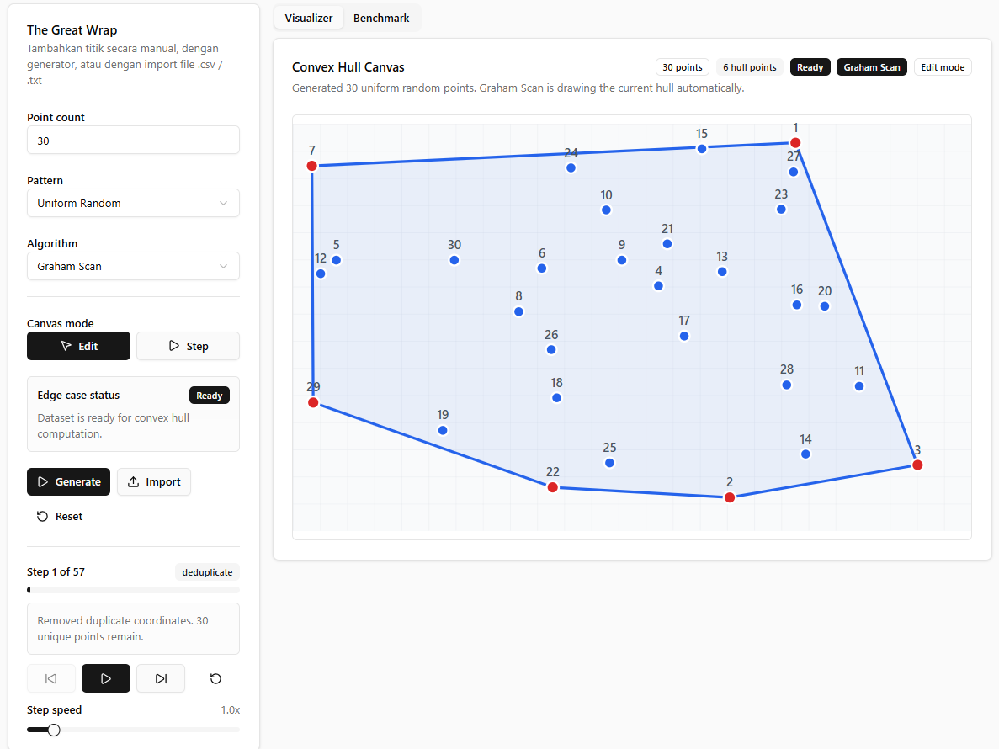
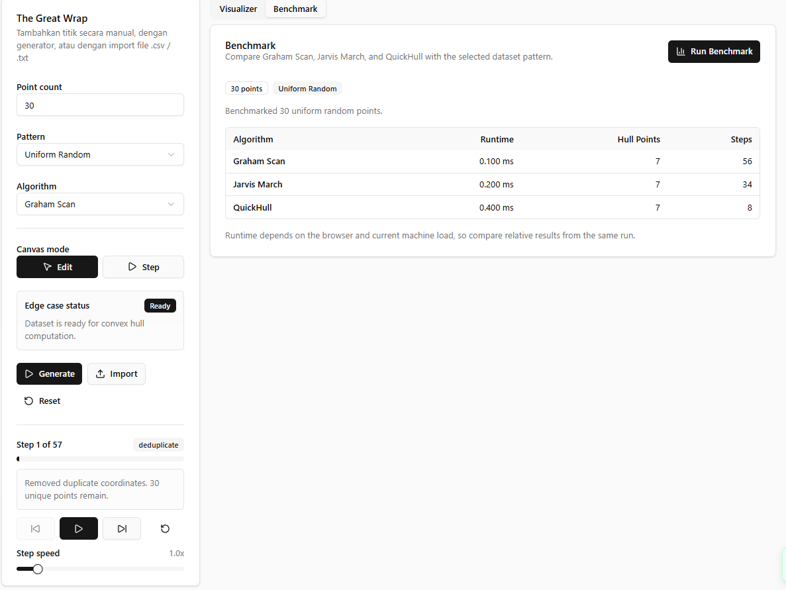

# The Great Wrap

The Great Wrap adalah aplikasi visualisasi Convex Hull berbasis web. Aplikasi ini
memungkinkan pengguna membuat dataset titik, memilih algoritma Convex Hull, melihat
hasil hull secara langsung, memutar visualisasi langkah demi langkah, dan
membandingkan performa algoritma.

Project ini dibuat dengan React, TypeScript, Vite, Tailwind CSS, dan shadcn/ui.


## Daftar Isi

- [Tech Stack](#tech-stack)
- [Fitur Utama](#fitur-utama)
- [Fitur Bonus](#fitur-bonus)
- [Algoritma](#algoritma)
- [Screenshot](#screenshot-hasil-program)
- [Cara Menjalankan](#cara-menjalankan)
- [Cara Menggunakan Aplikasi](#cara-menggunakan-aplikasi)
- [Format File Dataset](#format-file-dataset)
- [Test Case Manual](#test-case-manual)
- [Struktur Folder](#struktur-folder)

## Tech Stack

- React
- TypeScript
- Vite
- Tailwind CSS
- shadcn/ui
- Vitest


## Fitur Utama

### 1. Visualisasi Titik

Pengguna dapat menambahkan titik secara manual dengan klik pada canvas SVG.
Setiap titik diberi nomor agar lebih mudah diamati. Titik juga dapat
dihapus dengan klik langsung pada titik tersebut.

Canvas memakai koordinat SVG berukuran `1000 x 600`, titik diluar ukuran canvas tidak akan terbaca atua dilewati.

### 2. Input Dataset

Aplikasi mendukung beberapa cara memasukkan dataset:

- tambah titik manual dengan klik canvas,
- generate dataset otomatis berdasarkan jumlah titik,
- import file `.csv` atau `.txt`,
- reset dataset,
- hapus titik individual.

Format import yang didukung:

- `x,y`
- `x y`
- header `x,y` pada baris pertama.

Baris invalid akan dilewati pada program ini.

### 3. Perhitungan Convex Hull

Hull dihitung otomatis setiap kali:

- titik ditambah,
- titik dihapus,
- dataset digenerate,
- file diimport,
- algoritma diganti.

Hasil hull digambar langsung pada canvas:

- polygon biru untuk hull dengan minimal 3 titik,
- garis biru untuk kasus hull 2 titik,
- titik hull diberi warna merah.

### 4. Kontrol Algoritma

Pengguna dapat memilih algoritma dari dropdown:

- Graham Scan
- Jarvis March
- QuickHull

Pemilihan algoritma tersambung lewat controller `calculateConvexHull`, sehingga
UI memakai jalur yang sama untuk semua algoritma.

## Fitur Bonus

### Dynamic Convex Hull

Convex hull selalu dihitung ulang secara otomatis saat dataset atau pilihan
algoritma berubah.

### Step-by-Step Visualization

Aplikasi menyediakan mode `Step` untuk melihat proses algoritma per langkah.
Kontrol yang tersedia:

- previous step,
- next step,
- play atau pause,
- reset step,
- pengaturan kecepatan playback.

Warna visualisasi step:

- oranye: titik atau garis yang sedang aktif diperiksa,
- merah: titik hull sementara,
- biru: titik biasa.

### Dataset Generator

Dataset dapat dibuat otomatis dengan beberapa pola:

- Uniform Random
- Circle
- Rectangle
- Gaussian
- Cluster

Jumlah titik dapat diatur melalui input `Point count`.

### Edge Case Handling

Aplikasi menangani beberapa edge case:

- dataset kosong,
- titik kurang dari 3,
- titik duplikat,
- semua titik kolinear,
- baris file invalid,
- titik import di luar canvas,
- titik kolinear di sisi hull.

Untuk titik duplikat, aplikasi menyimpan kemunculan pertama dan melewati duplikat
berikutnya.

### Benchmark Algoritma

Tab `Benchmark` dapat menjalankan semua algoritma pada dataset sintetis yang sama.
Hasil benchmark menampilkan:

- runtime,
- jumlah titik hull,
- jumlah step yang tercatat.

Benchmark berguna untuk membandingkan Graham Scan, Jarvis March, dan QuickHull
dengan jumlah titik serta pola dataset yang sama.

## Algoritma

### Graham Scan

Graham Scan bekerja dengan memilih pivot, mengurutkan titik berdasarkan sudut
polar terhadap pivot, lalu membangun hull menggunakan stack.

Langkah utama:

1. Hapus titik duplikat.
2. Pilih pivot dengan `y` terkecil, lalu `x` terkecil.
3. Urutkan titik lain berdasarkan sudut polar terhadap pivot.
4. Masukkan titik ke stack.
5. Jika tiga titik terakhir membentuk belokan clockwise atau kolinear, titik
   tengah dikeluarkan dari stack.
6. Stack akhir menjadi convex hull.

Kompleksitas:

- rata-rata: `O(n log n)`

Implementasi utama:

- `src/algorithms/grahamScan.ts`

### Jarvis March

Jarvis March, atau Gift Wrapping, membungkus titik dari sisi paling luar. Algoritma
ini mulai dari titik paling kiri, lalu terus memilih titik berikutnya yang paling
luar sampai kembali ke titik awal.

Langkah utama:

1. Hapus titik duplikat.
2. Pilih titik paling kiri sebagai titik awal.
3. Ambil kandidat titik berikutnya.
4. Bandingkan kandidat dengan semua titik lain memakai orientasi cross product.
5. Jika ada titik yang lebih luar, kandidat diganti.
6. Ulangi sampai kembali ke titik awal.

Kompleksitas:

- `O(nh)`, dengan `h` adalah jumlah titik pada hull.

Implementasi utama:

- `src/algorithms/jarvisMarch.ts`

### QuickHull

QuickHull membagi masalah berdasarkan garis dari titik paling kiri ke titik paling
kanan. Titik terjauh dari garis dipilih sebagai bagian hull, lalu proses dilakukan
rekursif pada dua segmen baru.

Langkah utama:

1. Hapus titik duplikat.
2. Pilih titik paling kiri dan paling kanan sebagai baseline.
3. Pisahkan titik di sisi atas dan bawah baseline.
4. Untuk tiap sisi, cari titik terjauh dari garis.
5. Rekursif pada segmen kiri dan kanan dari titik terjauh.
6. Urutkan hasil hull agar polygon SVG tidak saling silang.

Kompleksitas:

- rata-rata: `O(n log n)`
- worst case: `O(n^2)`

Implementasi utama:

- `src/algorithms/quickHull.ts`


## Screenshot Hasil Program




## Cara Menjalankan

Install dependency:

```bash
npm install
```

Jalankan development server:

```bash
npm run dev
```

Buka URL yang ditampilkan Vite, biasanya:

```text
http://localhost:5173
```

Build production:

```bash
npm run build
```

Preview hasil build:

```bash
npm run preview
```

## Cara Menggunakan Aplikasi

Alur penggunaan dasar:

1. Isi `Point count` jika ingin memakai generator.
2. Pilih pola dataset pada dropdown `Pattern`.
3. Klik `Generate`, atau klik canvas untuk menambah titik manual.
4. Pilih algoritma pada dropdown `Algorithm`.
5. Lihat hasil hull otomatis pada canvas.
6. Masuk ke mode `Step` untuk melihat proses algoritma.
7. Buka tab `Benchmark` untuk membandingkan performa algoritma.

Alur import file:

1. Klik tombol `Import`.
2. Pilih file `.csv` atau `.txt`.
3. Aplikasi akan membaca titik valid.
4. Baris invalid atau duplikat akan dilewati dan dilaporkan pada UI.

## Format File Dataset

Format dengan koma:

```csv
x,y
100,100
300,100
300,300
100,300
200,200
```

Format dengan spasi:

```text
100 100
300 100
300 300
100 300
200 200
```

Aturan import:

- koordinat harus berupa angka,
- `x` harus berada di rentang `0..1000`,
- `y` harus berada di rentang `0..600`,
- header `x,y` boleh digunakan,
- baris kosong dilewati,
- baris invalid dilewati,
- titik duplikat dilewati setelah kemunculan pertama.

## Test Case Manual

Folder `testcase` berisi dataset manual untuk mencoba edge case:

- `valid-square-with-inner-point.csv`
- `duplicate-points.csv`
- `collinear-points.csv`
- `less-than-three-points.csv`
- `invalid-rows.csv`
- `mixed-edge-cases.txt`

File-file tersebut dapat langsung diimport melalui tombol `Import`.

## Struktur Folder

```text
src/
  algorithms/
    geometry.ts
    grahamScan.ts
    jarvisMarch.ts
    quickHull.ts
    convexHull.ts
  components/
    visualizer/
      PointCanvas.tsx
    ui/
  types/
    hull.ts
    point.ts
  utils/
    benchmark.ts
    datasetGenerator.ts
    edgeCases.ts
    fileParser.ts
    pointList.ts
    stepPlayback.ts
  visualizer/
    pointVisualState.ts
    svgCoordinates.ts
    svgPath.ts
testcase/
```

## Referensi 
- Graham Scan : [Converx Hull Using Graham Scan](https://www.geeksforgeeks.org/dsa/convex-hull-using-graham-scan/)

- Jarvis March : [Convex Hull using Jarvis' Algorithm or Wrapping](https://www.geeksforgeeks.org/dsa/convex-hull-using-jarvis-algorithm-or-wrapping/)

- Quickhull : [Quickhull Algorithm for Convex Hull](https://www.geeksforgeeks.org/dsa/convex-hull-using-jarvis-algorithm-or-wrapping/)


## Link Video Demo
[Link Video Demo](https://drive.google.com/drive/folders/1dSXcAJ_P8qEvjOPFO_rH857qia6qwVg4?usp=sharing)